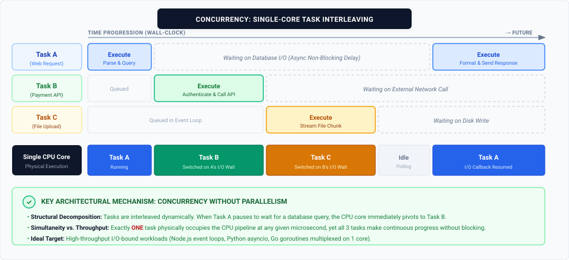
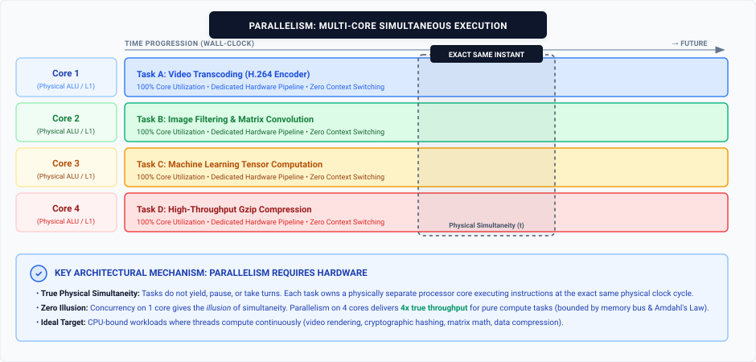

In software engineering, the terms "concurrency" and "parallelism" are frequently used interchangeably. However, they represent fundamentally different paradigms in computer science. Understanding the distinction is not just a matter of semantics, it is a critical architectural decision that dictates how a system scales, handles load, and utilizes hardware. 

Rob Pike, co-designer of the Go programming language, captured the core difference succinctly in his canonical talk:

> *"Concurrency is about dealing with lots of things at once. Parallelism is about doing lots of things at once. Concurrency is about structure, parallelism is about execution."*

At its core, **concurrency is about *managing* multiple tasks at once**, while **parallelism is about *executing* multiple tasks at the exact same physical moment.**

Let's break down the mechanics of each, see how they operate under the hood, and establish a clear framework for how modern systems leverage them.

---

## Concurrency: The Art of Task Management

Concurrency is a structural design pattern. It allows a system to deal with multiple things at once, but they do not necessarily execute at the exact same millisecond. 

Imagine a single-core server handling 10,000 open network connections at the same time. To an outside observer, it looks like magic as if the single core is processing 10,000 things at once. In reality, it is utilizing concurrency.

When a task requires data from a database or a file system, there is an inherent delay (while waiting for disk I/O or network latency). Instead of the CPU sitting idle and blocking the queue while waiting for that data to return, the operating system pauses the current task, saves its state (context switch), and begins working on the next task in the queue. 

**Real-world analogy:** A single barista making two separate coffee orders. They start brewing an espresso shot for Order A, and while that machine drips, they immediately turn to steam milk for Order B. Both orders are in progress concurrently, but the barista is only executing one physical action at a time.

### Visualizing Concurrency (Single-Core Interleaving)

---

## Parallelism: Brute Force Execution

Parallelism is not a structural pattern; it is a physical hardware capability. It requires multiple processing units (multi-core processors, multiple CPUs, or distributed nodes). 

In a parallel system, a workload is split into independent execution units, and the hardware computes them at the exact same instant. There is no illusion or context switching required to achieve simultaneity. 

If we give our server four independent cores, four different tasks can run simultaneously without any overlapping or sharing of a single CPU's attention. 

**Real-world analogy:** Two baristas working on two completely separate espresso machines. Order A and Order B are being prepared simultaneously from start to finish.

### Visualizing Parallelism (Multi-Core Simultaneous)

---

## The Golden Rule: When to Use Which?

Choosing between concurrency and parallelism comes down to understanding the nature of the bottleneck in your application. Is your work **I/O-bound** or **CPU-bound**?

### 1. I/O-Bound Work = Concurrency Wins
If your application spends most of its time waiting on querying databases, reading files from a disk, or waiting on responses from external third-party APIs your system is I/O-bound. 

In this scenario, throwing more CPU cores (parallelism) at the problem will not inherently speed up the application. Instead, **concurrency is the answer.** A single, efficiently managed thread can handle an enormous amount of traffic simply by utilizing the idle wait times to process other requests. 

### 2. CPU-Bound Work = Parallelism is Required
If your application is doing heavy computational lifting resizing high-resolution images, encoding video, processing massive data sets, or training machine learning models the CPU is actively engaged 100% of the time. 

In a CPU-bound scenario, concurrency will actually slow you down. If a single core tries to rapidly context-switch between two heavy math problems, it introduces overhead without any benefit. To truly speed up CPU-bound tasks, **you must use parallelism**. You need to distribute the workload across multiple physical cores so the math can be done simultaneously.

---

## The Convergence: Concurrency and Parallelism Together

A common misconception when learning these concepts is assuming that an architecture must pick one or the other. In reality, **concurrency and parallelism are complementary, not mutually exclusive.** Modern, high-scale production systems always combine both to deliver maximum throughput and low latency.

Consider how major modern runtimes and platforms achieve this synergy:

* **Go (The `M:N` Scheduler):** Go treats concurrency as a first-class language primitive through lightweight goroutines (`M`). But rather than pinning them to a single thread, Go's runtime scheduler multiplexes thousands of concurrent goroutines onto a pool of operating system threads (`N`) mapped directly to all available CPU cores. You get massive I/O concurrency alongside true hardware parallelism.
* **Node.js & Python:** Historically celebrated for non-blocking I/O on a single thread (pure concurrency), both ecosystems scale heavy workloads by pairing concurrency with parallelism. Node.js leverages `worker_threads` or cluster mode (spawning multiple V8 processes across cores), while Python uses `multiprocessing` or Celery task workers. The main event loop handles thousands of concurrent socket connections, delegating heavy CPU-bound payloads to parallel worker pools.
* **Java (Project Loom & Virtual Threads):** Traditional Java applications relied on heavyweight platform threads with a 1:1 mapping to OS threads. While this provided robust multi-core parallelism, it hit scalability limits under massive concurrent I/O due to stack memory overhead and context-switching penalties. With Virtual Threads, Java decouples logical threads from OS carrier threads, allowing millions of concurrent tasks to execute across a parallel pool of CPU cores without thread exhaustion.

---

## Summary: Architecture Comparison

To quickly determine which paradigm fits your workload, here is how concurrency and parallelism compare side-by-side:

| Dimension | Concurrency | Parallelism |
| :--- | :--- | :--- |
| **Core Philosophy** | Structuring a program by breaking it into distinct, manageable tasks | Executing multiple computations simultaneously |
| **Focus** | **Structure** (Dealing with multiple things at once) | **Execution** (Doing multiple things at once) |
| **Hardware Prerequisite** | 1 CPU core is sufficient | Requires `>= 2` physical CPU cores or nodes |
| **Primary Mechanism** | Context switching, cooperative multitasking, non-blocking event loops | Multiple independent hardware pipelines (ALUs, caches) |
| **Ideal Bottleneck** | **I/O-Bound:** Network latency, DB queries, file system calls | **CPU-Bound:** Image/video rendering, matrix math, hashing |
| **Language Primitives** | `async/await`, Promises, Event loops, Goroutines, Channels | OS Threads, Thread Pools (`ForkJoinPool`), Web Workers, Multiprocessing |
| **Primary Risk / Trap** | Race conditions, deadlocks, unhandled promise rejections | Memory bus saturation, cache coherency overhead, false sharing |

---

## Wrapping Up

*   **Concurrency** is about structuring a program to deal with multiple things at once, highly effective for keeping systems responsive during I/O delays.
*   **Parallelism** is about executing multiple things at once, essential for speeding up raw computational tasks across multiple cores. 

Knowing the difference allows you to stop throwing expensive hardware at I/O problems, and stops you from relying on single-threaded event loops for heavy mathematical lifting. By understanding whether your bottleneck is waiting for I/O or waiting for compute, you can choose the right abstraction and leverage both to build fast, scalable, and resilient software.